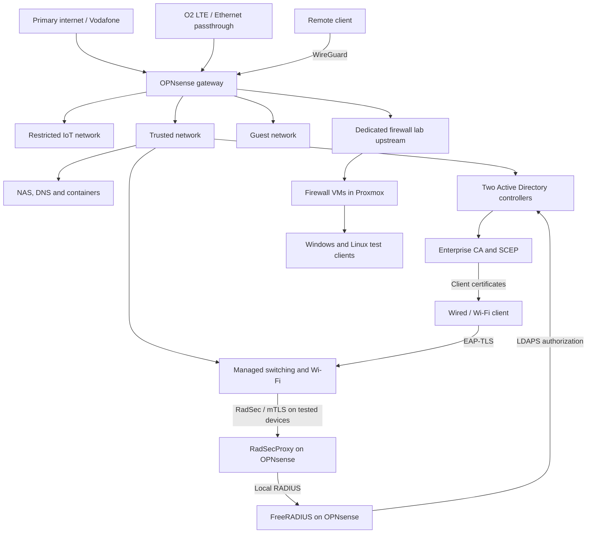

# BiXCore network architecture

This simplified diagram shows how the main services relate. It is not a physical port map.

The LTE backup is selective: Core and IoT can use the backup IPv4 path, while Guest and the IPv6-only lab are not given unrestricted LTE access. RadSec secures transport for the two UniFi APs and the tested Omada switch; it does not replace end-device EAP-TLS. The virtual firewall lab has its own upstream and client bridges. Some negative-path access tests are still open.
