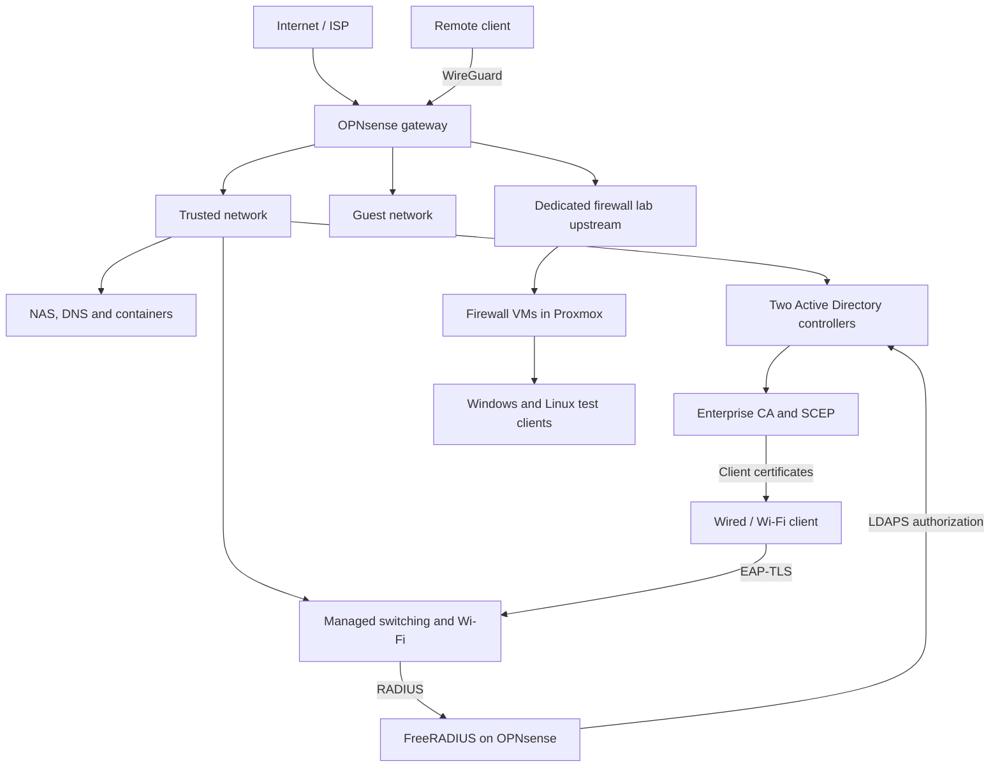

# BiXCore network architecture

This simplified diagram shows how the main services relate. It is not a physical port map.

The virtual firewall lab has its own upstream and client bridges. Some negative-path access tests are still open.
