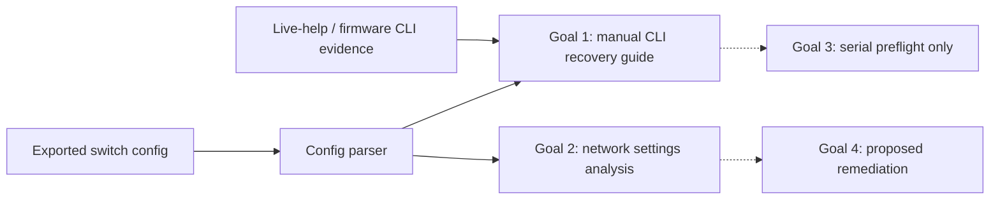

# BiX Barox Config Tool — simplified architecture

**As of 4 November 2026:** Goal 1 and Goal 2 are implemented; the selected Goal 3 hardware probes and preflight exist, but the automated executor does not. Goal 4 is an unimplemented concept. The source repository is private and is not linked here because it contains device-specific research material.
