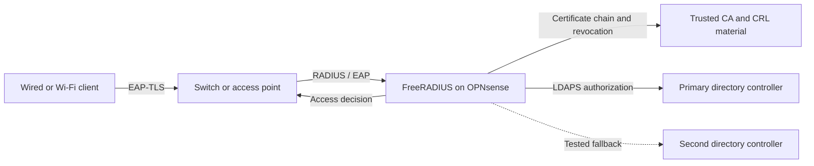

# How EAP-TLS works in BiXCore

The client authenticates with a certificate; FreeRADIUS also applies access policy. The directory fallback was tested separately from issuing CA and SCEP availability.
