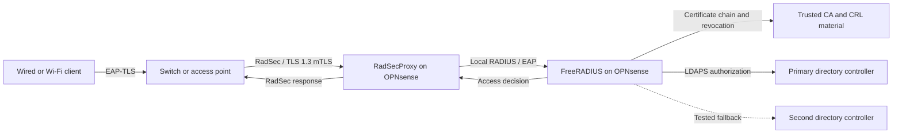

# How EAP-TLS works in BiXCore

The client authenticates with an EAP-TLS certificate; FreeRADIUS also applies access policy. For the two UniFi APs and the tested Omada switch, the separate RadSec transport authenticates the network device and proxy with their own certificates. This diagram shows that tested path, not every RADIUS client. The directory fallback was tested separately from issuing CA and SCEP availability.
