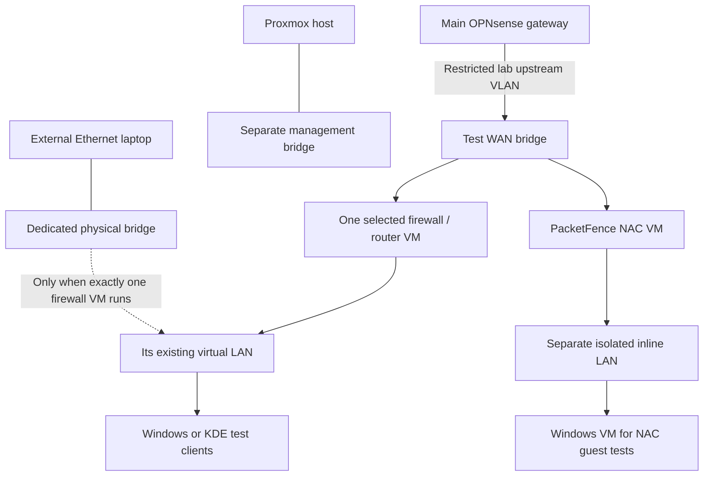

# Proxmox lab — firewall VMs and NAC

I have **14 VMs**: 11 firewall/router platforms, two reusable clients and one PacketFence NAC VM. The external laptop was tested across all eleven firewall platforms, using a Proxmox host hookscript to connect it to the active guest LAN. The physical port disconnects if two or more firewall VMs are running.

PacketFence is a separate virtual NAC test; it does **not** use that physical port. Captive-portal registration and guest access revocation work in the VM test, while RADIUS/802.1X and physical PacketFence clients remain untested. The full lab-to-core isolation matrix and independent VM backups are also open.
