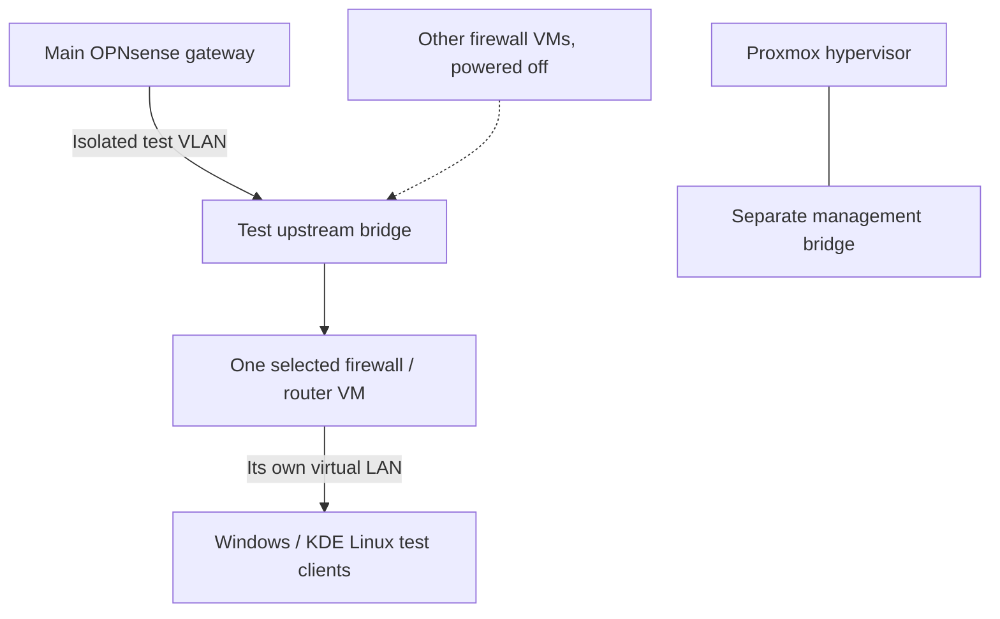

# Proxmox firewall lab

The lab has a dedicated IPv4 test upstream supplied by the main OPNsense gateway. Proxmox management stays on a separate interface, while each test firewall uses its own virtual client bridge.

I have 11 firewall/router systems and two client VMs, but normally run only the ones needed for a test. The four most recent firewall additions are NethSecurity, FreeSense, DD-WRT and a separate OPNsense Community instance.

I checked their management interfaces, outbound IPv4 connectivity and controlled RDP forwarding to the test clients. The complete negative-path isolation matrix, IPv6-only upstream and independent VM backup tests are still open.
