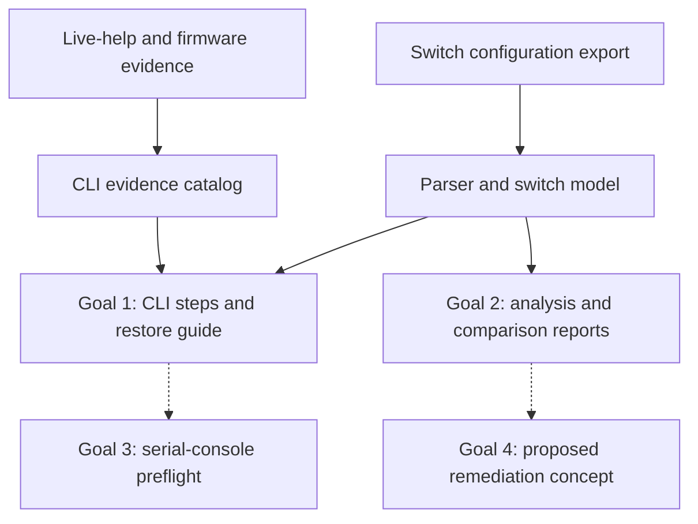
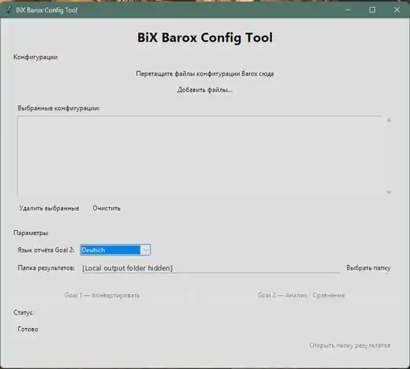

# BiX Barox Config Tool

**Type:** Personal software and networking engineering project  
**Status:** Goal 1 and Goal 2 implemented; Goal 3 partially implemented; Goal 4 a future concept  
**Public overview:** [BiX Barox Config Tool](../docs/pages/barox-config-tool.html)

## Why I started it

My work with networked electronic security systems includes managed industrial switches. A configuration export is useful, but understanding exactly how to reproduce it — and which settings differ across a system — takes more than copying lines into a terminal.

I began building **BiX Barox Config Tool** to convert Barox running/startup exports into documented CLI steps for **manual** recovery. The project later expanded into switch configuration analysis, a small Windows GUI, serial-console experiments and separate CLI grammar research.

## Architecture

The solid arrows represent existing input/output relationships. The dashed arrows mark partial or planned extensions: the Goal 3 general restore executor does **not** exist, and Goal 4 has not been implemented.

*Screenshot of the offline Windows GUI, without loaded configurations or a personal filesystem path.*

## Implemented and planned

| Area | Evidence-backed status | Limit |
| --- | --- | --- |
| Goal 1 — offline converter | Produces ordered CLI steps, explanation, source mapping and a machine-readable plan | A generated command is not approval to run it; unknown syntax is flagged |
| Goal 2 — configuration comparator | Local checks for one switch; cross-switch checks for exports from the same actual system; English, German and Russian reports | It cannot infer a real cable or physical topology from incomplete configuration evidence |
| Windows GUI | File selection, drag/drop, output directory and Goal 1/2 actions | Does not configure devices |
| Goal 3 — serial console | Selected hardware-backed prompt/context probes and offline capability checks | General command execution, verification and recovery workflow unfinished |
| Goal 4 — findings-to-fix planner | Concept approved | No accepted detailed specification or implementation |
| CLI research | 6,644 catalog records in eight contexts for the main referenced Barox model and firmware | Catalog entries are syntax/evidence records, not 6,644 executed commands |

## Selected problems I worked through

**CLI grammar and evidence:** I separated direct device help from firmware-derived syntax and tracked what each source can support. Command syntax, a valid parameter and successful execution are three different claims.

**Configuration semantics:** The comparison engine distinguishes VLAN-scoped addresses, selected effective defaults and unknown topology information from definite findings. Reports keep underlying finding IDs and structured results separate from their EN/DE/RU presentation.

**Serial transport:** Fragmented echo, prompt recognition, idle deadlines and the difference between observation and applying a configuration all require explicit handling. Selected state transitions were tested on a physical device; a complete restoration was not.

## Validation and open work

The private engineering documentation inventories **515 unittest cases** (192 root and 323 output-suite cases). A successful full run was previously reported during development, not rerun during the latest documentation update. Preserved hardware evidence covers selected serial probes and context transitions, not all commands or all Barox models.

Still open: safer handling of sensitive values in generated restore reports, further command validation on new exports, a general Goal 3 restore executor, and any future Goal 4 remediation logic.

## Publication boundary

The implementation repository is intentionally **private** because it includes research captures, device-specific outputs and generated recovery artifacts. This public article contains **no actual configuration exports, internal addresses, credentials, raw CLI transcripts or restore scripts**.

The tool is an independent personal project, not an official product of Barox.
