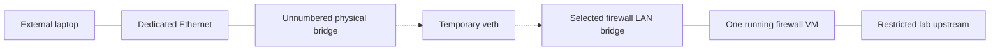

# PhyLan1: A Physical Client for the Firewall Lab

**Tested 6 November 2026:** one external Ethernet laptop with the eleven Proxmox firewall/router VMs.

I wanted to put a real laptop on the LAN of whichever firewall I was testing without adding a dedicated NIC to every guest. The host now uses a bridge with a dedicated physical port and no host IP address, plus a temporary virtual Ethernet pair to the selected firewall's existing LAN.

The Proxmox hookscript handles ordinary VM start and stop events and serializes the switch-over. With zero running firewalls the port is disconnected; with exactly one it is connected to that VM's LAN; with two or more it is disconnected again.

I tested handovers, simultaneous two-VM and three-VM runs, and the reconnection when only one firewall remained. I also confirmed internet, RDP forwarding and the external laptop path for all eleven platforms. Those are user-confirmed end-to-end checks, not separate packet captures for every VM.

Unplanned QEMU termination without a normal stop event is not watched by a background watchdog. I also haven't completed the full lab-to-core isolation matrix. The port is for a direct cable or an isolated test AP, not the home switch.

[Read the project](../docs/pages/phylan1.html) · [Firewall lab](../docs/pages/proxmox-firewall-lab.html)
